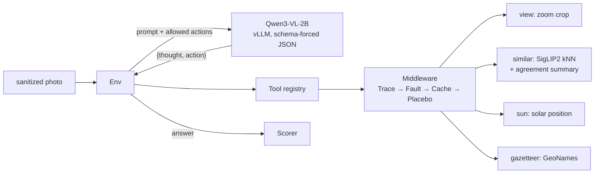

# Retrace

A tool-using agent that predicts **where** (lat/lon) and **when** (date, time of day) a photo was taken
from its pixels alone. The model is a small local vision-language model (Qwen3-VL-2B, served with vLLM in
fp16 on one 8 GB GPU); the project is mostly about the **harness** around it and about measuring what each
piece of that harness actually contributes.

**Demo:** step-by-step trajectories on 18 street-view photos, three harness configurations side by side:
https://claude.ai/artifact/VKLBYRnzd9CZes3Qid1yW7 (rebuild with `scripts/export_demo.py`).

## Harness



| Piece | What it does | Code |
|---|---|---|
| Action format | Each turn the model emits `{"thought", "action": {"tool", "args"}}`; the JSON schema is an `anyOf` over only the actions currently allowed, so invalid calls cannot be generated | `src/retrace/env` |
| Budgets | 6 steps, 4 images, 6,144-token context; when the next turn would not fit, only `answer` is allowed (forced answer) | `src/retrace/env` |
| Tool registry | Tools are plain dataclasses with a real function and a placebo; per-photo or global caching | `src/retrace/tools` |
| Middleware | `Trace` (logs every call, turns crashes into error text the agent can recover from), `Fault` (injected failures), `Cache`, `Placebo` (plausible but uninformative outputs) | `src/retrace/middleware` |
| Skills | Short procedure files appended to the instruction (`skills/*.md`), selected per run | `skills/` |
| Trajectories | Every step's thought, action, observation, tokens and latency, written per episode | `scripts/run_agent.py` |
| Leakage control | Images re-encoded from pixels (no EXIF/XMP/ICC), labels never reach the agent, the photo's own capture sequence is excluded from retrieval | `LEAKAGE.md`, `tests/test_leakage.py` |

## How results are measured

* Location score `geo_shaped` (0–1, distance-based), accuracy at 25/200/750/2,500 km, and time metrics.
* **Paired bootstrap** (2,000 resamples) on the same photos; a difference is called real only when the
  95% interval excludes 0.
* Every harness feature ships with an **ablation**, a **placebo** where it makes sense, and token and
  latency cost. Held-out tests are **pre-registered** in `DECISIONS.md` before they run.

## Results so far (same photos per column: OSV-5M val dev300, Im2GPS3k dev500)

| Configuration | Street view (OSV-5M) | Flickr (Im2GPS3k, dev500) |
|---|---|---|
| kNN-10 on SigLIP2 embeddings (no LLM) | 0.733 | 0.440 |
| Model alone, one look | 0.650 | **0.603** |
| Agent with tools, no skill | 0.670 | 0.593 |
| Agent with placebo tools | 0.501 | – |
| Agent + `playbook_v1` skill | **0.736** | 0.536 |
| Agent + `playbook_v2` + agreement line | 0.706 | 0.578 |
| Agent + `playbook_v1` + agreement line | 0.721 | 0.550 |

What the experiments showed:

1. **The tools are used, not just the extra turns.** Placebo tools drop the score from 0.670 to 0.501.
2. **A short procedure helps; extra text does not.** `playbook_v1` adds +0.06 on 1,694 held-out photos
   (pre-registered pass). A same-length garbage skill does nothing; correct but generic geo tips hurt
   (−0.037). Rewording and sampling seeds keep +0.04 to +0.05.
3. **Retrieval over-trust out of distribution.** On Flickr photos the street-view index returns wrong
   lookalikes and the playbook makes the agent copy them (−0.067 vs the model alone). Without the skill the agent
   matches the model alone (−0.010), so the skill, not the tools, causes the loss: +0.066 on street
   view, −0.057 on Flickr.
4. **Compute the signal; don't ask a 2B model to.** Neighbor agreement predicts whether kNN is right on
   both datasets, but the model cannot work it out from coordinates. Having `similar` print a computed
   agreement line recovers +0.029 on Flickr and is neutral on street view.

Full tables: `results/baselines.md`. Every non-obvious choice, with alternatives: `DECISIONS.md`.

## Known issue

Some dashcam photos have the capture date/time (rarely GPS) burned into the pixels by the camera overlay
(`LEAKAGE.md` L-15/L-16, `DECISIONS.md` D-051). Sanitizing removes file metadata, not pixels, and the agent
reads these timestamps. An OCR audit (`scripts/audit_overlays.py`) flags 3.9% of OSV-5M val photos. With
them removed, every location conclusion above holds (differences move by at most 0.003); time metrics are
inflated by them (the model alone's exact-year accuracy drops from 5.1% to 1.1%), so time results are also
reported on clean photos. Details: `results/baselines.md`.

## Layout

```
src/retrace/   env, harness (agent loop), tools, middleware, score, splits, sanitize, ingest
scripts/       run_agent, score_run, baselines (kNN, model alone), analysis, demo export, audits
skills/        prompt skills (playbook_v1, v2, and the control arms)
results/       baselines.md, runs.csv, per-run JSON summaries, analysis
tests/         harness, leakage, scoring, sun, time labels
```

Data lives outside the repo (`$RETRACE_DATA`). Personal photos, if added, are a private test set only:
never trained on, never indexed, never sent to an external API, and kept under the gitignored
`data/private/`.
